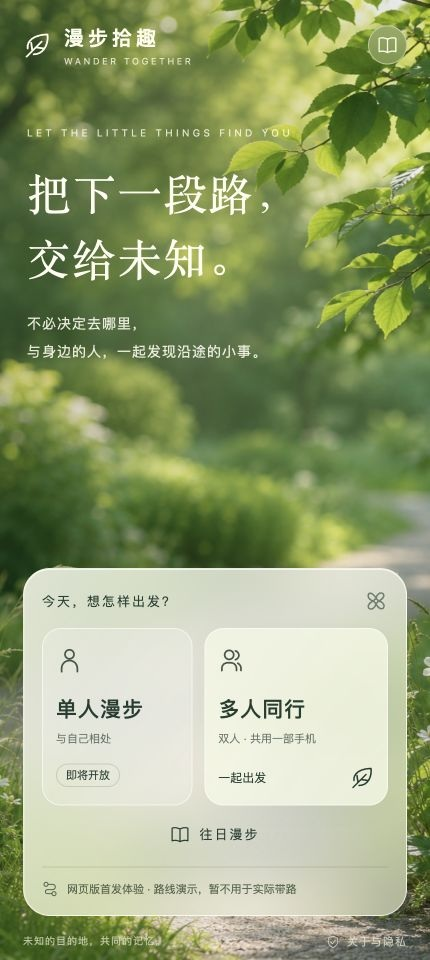
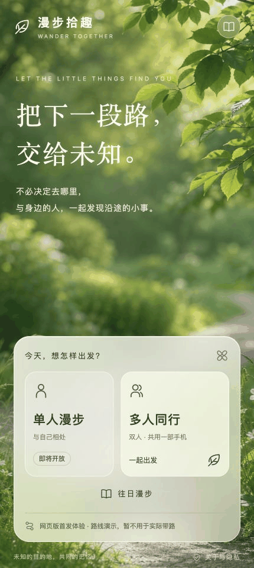

# 漫步拾趣 · 双人散步体验

漫步拾趣是一款供两个人共用一部手机的散步网页。它适合想出门又没想好去哪儿的朋友，也适合想找个轻松话题的初次见面。选好同行方式后，页面逐段给出方向，把地点留到后面揭晓。途中可以抽一张互动卡、拍张照，结束后把这些片刻收进同一篇日记。

  

## 为什么做

散步本来是一件很轻松的事，却常常从「去哪里」开始纠结。两个人刚认识时，也未必知道怎么开口。我想让出发简单一点，让沿途的风景和几个可选的小话题帮两个人找到聊天的机会。互动可以跳过，旅程也可以随时收存。

## 能做什么

- **选一段适合当下的漫步。** 从「多人同行」进入，选择「初识同行」或「熟悉相伴」，再选约 1、2 或 3 公里，以及返回起点或在随机地点结束。
- **轮流决定怎么玩。** 第一次抛硬币决定谁先选。之后两人轮流选择真心话、大冒险或一起参与，换题和略过会保留当前回合。
- **把沿途的发现留下来。** 可以给题卡加一张照片和一句话，也可以单独记录风景。收存后从「往日漫步」回看，在日记里整理标题、封面和文字，或制作分享卡。

当前网页使用示例路线，通过「体验下一段」推进，暂未接入真实定位与步行导航。日记和照片保存在当时使用的浏览器中。

## 从出发到分享卡

1. 在首页选择「多人同行」，用默认设置开启一段初识漫步。
2. 点击「开启一份互动」，填写示例昵称「小松」和「小苔」，抛硬币决定谁先选。
3. 选择「一起参与」，写下一句回应，加入一张示例照片，再点「留在旅程中」。
4. 点击「收存旅程」打开日记，再点「制作分享卡」，预览这一次漫步的纪念图。

  

动图由实际操作时截取的页面画面组成。昵称和记录文字均为虚构，照片使用项目自带的示例风景图。
